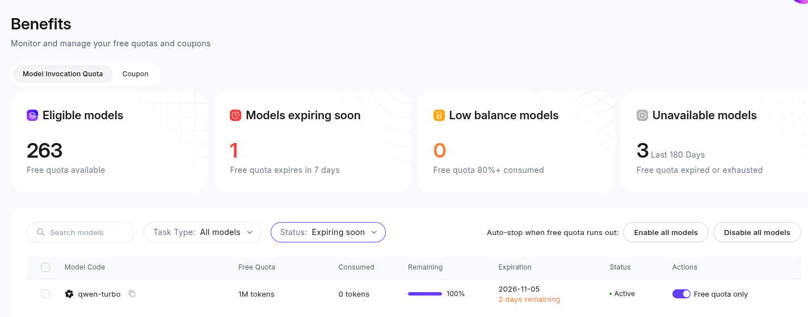

# Gorillas — Python Port

A faithful Python port of **QBASIC GORILLA.BAS** (Microsoft, 1990).

Two gorillas on city rooftops take turns throwing explosive bananas at each other,
accounting for wind, gravity, and the skyline. Runs natively on modern systems —
no DOSBox, no emulator.



## Setup

```bash
python -m venv .venv
# Linux/macOS:
source .venv/bin/activate
# Windows:
# .venv\Scripts\activate

pip install -r requirements.txt
```

## Running

```bash
python game.py
```

### Command-line options

| Flag | Default | Description |
|---|---|---|
| `--scale N` | 0 (auto-fit) | Integer scale factor for the window |
| `--fullscreen` | off | Start in fullscreen mode |
| `--mute` | off | Disable all sound |
| `--speed X` | 1.0 | Speed multiplier (>1 = faster, <1 = slower) |

Examples:
```bash
python game.py --scale 2           # 2× window size
python game.py --fullscreen        # fullscreen
python game.py --speed 2.0 --mute  # double speed, no sound
```

## Standalone Executable (All Platforms)

For easy distribution, you can build a standalone executable that doesn't require Python installation:

### Quick Build

**Windows:**
```cmd
build.bat
```

**macOS/Linux/BSD:**
```bash
./build.sh
```

**All platforms (PowerShell):**
```powershell
pwsh build.ps1
```

### Output

| Platform | Executable | Self-Contained? |
|----------|-----------|-----------------|
| Windows 10/11 | `dist/gorillas.exe` | ✅ Yes (includes SDL2) |
| macOS | `dist/gorillas-macos` | ❌ Needs SDL2 via Homebrew |
| Linux | `dist/gorillas-linux` | ❌ Needs SDL2 packages |
| FreeBSD/OpenBSD/NetBSD | `dist/gorillas-{bsd}` | ❌ Needs SDL2 packages |

### Requirements

**For building:**
- Python 3.10+ with development headers
- SDL2 development libraries (except Windows)
- See [BUILD_GUIDE.md](BUILD_GUIDE.md) for platform-specific instructions

**For running:**
- Windows: Nothing! Just run the `.exe`
- macOS/Linux/BSD: SDL2 runtime libraries (usually pre-installed or easy to install)

### Cross-platform compatibility

- Build on each target platform separately
- Windows executables are self-contained (pygame-ce bundles SDL2 DLLs)
- macOS/Linux/BSD executables need SDL2 installed on the target system
- Build on the oldest target OS version for maximum compatibility
- See [BUILD_GUIDE.md](BUILD_GUIDE.md) for detailed instructions and troubleshooting

## Controls

| Key | Action |
|---|---|
| `Enter` | Confirm input |
| `0-9`, `.` | Enter angle/velocity |
| `Backspace` | Delete last digit |
| `V` / `P` | View intro / Play game (GorillaIntro choice) |

## How faithful is it?

**Pixel-identical** rendering where possible:
- Indexed framebuffer with palette applied at present-time (VGA behavior)
- Own Bresenham LINE, midpoint CIRCLE, and BFS PAINT rasterizers
- CP437 character set with real Px437 IBM EGA 8×14 bitmap font
- EGA 64-color palette decode (verified against all standard anchors)
- Banana sprites decoded from original DATA statements (byte-aligned planar)

**Behavior-preserved** semantics:
- `CINT()` banker's rounding, `INT()` floor, `FIX()` truncate
- Integer division `\\` and `MOD` truncate toward zero (not floor)
- 1-based `MID$`, `LEFT$`, `RIGHT$`, `INSTR`
- `PRINT` zones (14-column), semicolon/comma separators
- `PALETTE n, value` changes affect already-drawn pixels immediately

**Timing** converted to real wall-clock seconds:
- `Rest(t#)` ≈ `t#` seconds at speed=1.0
- `SLEEP n` = `n` real seconds (any key ends early)
- `--speed` multiplier for global pace adjustment

See `QUIRKS.md` for preserved bugs and intentional deviations.
See `TIMING_NOTES.md` for every delay conversion with source line citations.

## Project structure

```
game.py                   # Translated program (close to line-for-line)
qb_runtime/               # QBASIC semantics layer
  __init__.py
  qbmath.py               # CINT, INT, FIX, \\, MOD, int16 overflow, sng
  format.py               # STR$, VAL, LEFT$, MID$, RIGHT$, INSTR, etc.
  screen.py               # Screen modes, indexed framebuffer, palette, fonts
  text.py                 # PRINT, LOCATE, COLOR, CLS, VIEW PRINT, cursor
  graphics.py             # PSET, LINE, CIRCLE, PAINT, GET, PUT
  keyboard.py             # INKEY$, LINE INPUT, INPUT, GetNum#
  timing.py               # TIMER, Rest, SLEEP, --speed
  sound.py                # PLAY macro parser, BEEP, square waves
  rng.py                  # RND, RANDOMIZE
assets/fonts/             # Px437 bitmap fonts (EGA 8×14, CGA 8×8)
tests/                    # 137 tests (unit + golden + integration)
  test_qbmath.py          # 35 tests: numeric semantics
  test_format.py          # 47 tests: string/formatting
  test_smoke.py           # 42 tests: headless integration
  test_golden.py          # 13 tests: pixel-exact golden files
  golden/                 # 25+ reference PNG screenshots
INVENTORY.md              # Step 1: full source analysis
QUIRKS.md                 # Preserved bugs and deviations
TIMING_NOTES.md           # Delay conversion table
SKILL.md                  # Conversion methodology
```

## Testing

```bash
# All tests (headless):
SDL_VIDEODRIVER=dummy SDL_AUDIODRIVER=dummy .venv/bin/python -m unittest discover tests/

# Integration test (drives game through all screens):
SDL_VIDEODRIVER=dummy SDL_AUDIODRIVER=dummy .venv/bin/python tests/test_game_integration.py

# Generate golden files:
SDL_VIDEODRIVER=dummy SDL_AUDIODRIVER=dummy .venv/bin/python tests/diag_pixel_fidelity.py
```

## Requirements

- Python 3.10+
- pygame 2.6.1
- numpy 2.5.4

## Credits

Original GORILLA.BAS: Copyright (C) Microsoft Corporation 1990.
Px437 fonts: [The Ultimate Oldschool PC Font Pack](https://int10h.org/oldschool-pc-fonts/) (CC BY-SA 4.0).
Python port: see commit history for author attribution.
